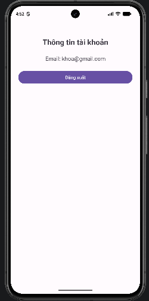
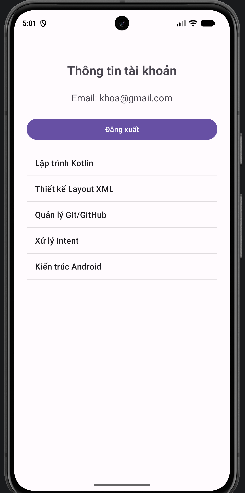
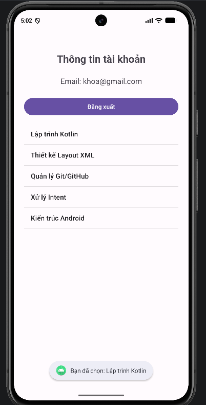

# BÀI THI THỰC HÀNH - LẬP TRÌNH ỨNG DỤNG DI ĐỘNG
- Họ và tên: Lê Nguyễn Đăng Khoa
- MSSV: 2374801020006
- Lớp: 261_71ITSE30603_0102

## Minh chứng Câu 1

## Minh chứng Câu 2

## Minh chứng Câu 3

> Xem từng câu tại các nhánh `cau-1`, `cau-2`, `cau-3`.